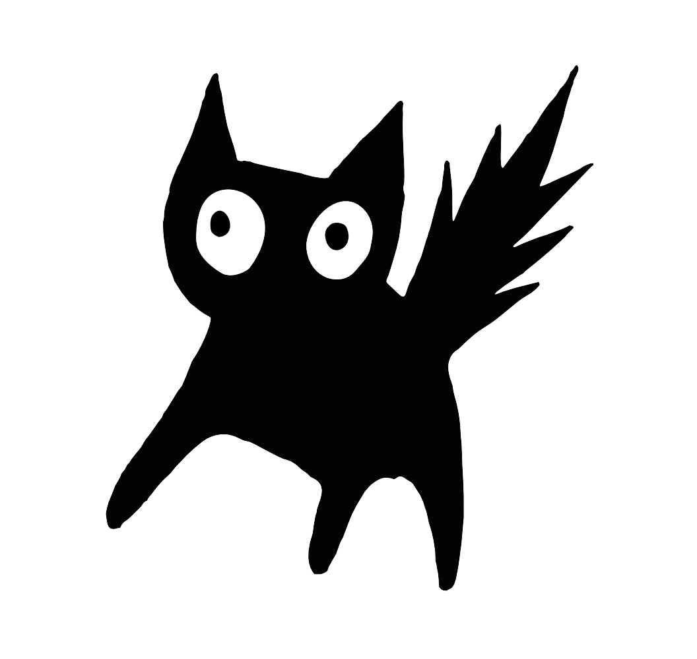

<br />
<div align="center">
    
    <h3 align="center">
     purr
  </h3>
  <p align="center">
      A *purr*ely functional programming language.
  </p>
</div>

<!-- ABOUT THE PROJECT -->
## About

This repository contains a compiler and interpreter for a lazy-evaluated programming language, such as Haskell, but with the charm of OCaml's syntax.

It is a recreational project built as a way to retain concepts like lambda calculus, graph reduction, type inference and lazy evaluation learnt from the Fundamentals and Implementation of Programming Languages courses of my Master's Degree in CS at FCUP and further explore PL theory and compiler design.

### What about Dobby?

Dobby is purr's mascot and is known for being a scaredy-cat that is afraid of poorly typed programs and only purrs when the code compiles successfully. Over time, Dobby has grown even more fearful, worrying about the type system and compiler correctness as well, therefore, in the future, both will be formally verified in Rocq.

## Type System

Much like any functional programming language, `purr` is strongly typed (at compile-time) and uses [Hindley-Damas-Milner algorithm J](https://en.wikipedia.org/wiki/Hindley%E2%80%93Milner_type_system#Algorithm_J) for inferring types without programmer intervention.

### Syntax
```
type ::= int | bool | float | string | type -> type | [type] 
```

### Examples

The type for the `map` function is the following:
```haskell
map : (a -> b) -> [a] -> [b]
```

And type polymorphism can be demonstrated by the following expression, where
`map` receives functions with different types:

```haskell
let incr_int := -- int -> int
    \x . x + 1
in

let incr_float := -- float -> float
    \x . x + 1.0
in

let _ := map incr_int [0,1,2] in

map incr_float [0.0, 1.0, 2.0]
```


## Language

The language consists of an extended lambda calculus and, as previously stated, has a syntax similar to ML-based languages like OCaml, SML and F#.

### Syntax
```
const ::= int | bool | float | [const]

op    ::= == | != | < | <= | > | >= | && 
             | || | + | - | / | * | :

var   ::= string | (custom_op)

term  ::= const | term op term 
                | let var := term in term 
                | let var : [string] = term in term 
                | let var : [string] : type = term in term
                | let rec var := term in term 
                | let rec var : [string] = term in term 
                | let rec var : [string] : type = term in term
                | \[string] . term
                | \[string] : type . term
                | if term then term else term
                | term term
                | term -- comment
```

### Examples

There are several examples you can try in the [`examples`](./examples) folder such as:

1. Increment
```haskell
let incr :=
  \x . x + 1
in

map incr [0,1,2]
```

2. Fibonnaci Sequence

```haskell
let rec fib : x =
    if x == 1 || x == 0
        then x
        else fib (x - 1) + fib (x - 2)
in

fib 10
```

3. Ascending List
```haskell
let rec ascending_rec : size current_size list
    = if current_size > size
        then list
        else current_size
             : ascending_rec size (current_size + 1) list
in

let ascending : size
    = ascending_rec size 1 []
in

ascending 10
```

## Standard Library

A set of predefined functions that are automatically compiled with every program. Check out the [implementation](./stdlib/common.pr).

```haskell
--
-- Standard Library for the *purr* functional programming language.
--

--
-- Operators
--

-- Operator that represents a pipe (inspired by OCaml) where the first
-- argument is applied to the second (f x <=> x |> f).
let (|>) : x f : a -> (a -> b) -> b
    = f x
in

-- Alternative operator for different (!=) (for OCaml lovers).
let (<>) : x y : a -> a -> bool
    = x != y
in

--
-- Lists
--

-- Function that checks if a list is empty.
let is_empty : l : [a] -> bool
    = l == []
in

-- Function that applies a given function `f` to all elements of `l`.
let rec map : f l : (a -> b) -> [a] -> [b] =
    if is_empty l
        then []
        else f (head l) : tail l |> map f
in

-- Function that applies a given function `f` to all elements of `l`
-- (leftwise) carrying an accumulator `acc`.
let rec fold_left : f acc l : (a -> b -> a) -> a -> [b] -> a =
    if is_empty l
        then acc
        else fold_left f (head l |> f acc) (tail l)
in

-- Function that returns the number of elements in a list
let len : l : [a] -> int =
    fold_left (\acc x . acc + 1) 0 l
in

-- Function that filters out elements of `l` that do not satisfy the
-- condition `p`.
let rec filter : p l : (a -> bool) -> [a] -> [a] =
    if is_empty l
        then []
        else
            let h := head l in
            let t := tail l in
            if p h
                then h : filter p t
                else filter p t
in
```

## Getting Started

### Prerequisites

In order to run this project from source, you will need to have Haskell and `cabal` installed.

### Command-line Tool

Before executing the program you have to compile the lexer and the parser with the following commands:
```bash
# compile the lexer
alex src/Lexer.x

# compile the parser
happy src/Parser.y --ghc
```

Then you have to install the command-line tool:
```bash
cabal install exe:purr
```

Then, you can execute programs written in files with the following command:
```bash
purr <file_path>
```

And use a playground environment with:
```bash
purr
```

## References

The study material I used to learn the concepts required to implement `purr` where:

- Professor Mario Florido's lecture notes;
- *Implementing Functional Languages: a tutorial* - Simon Peyton Jones.
